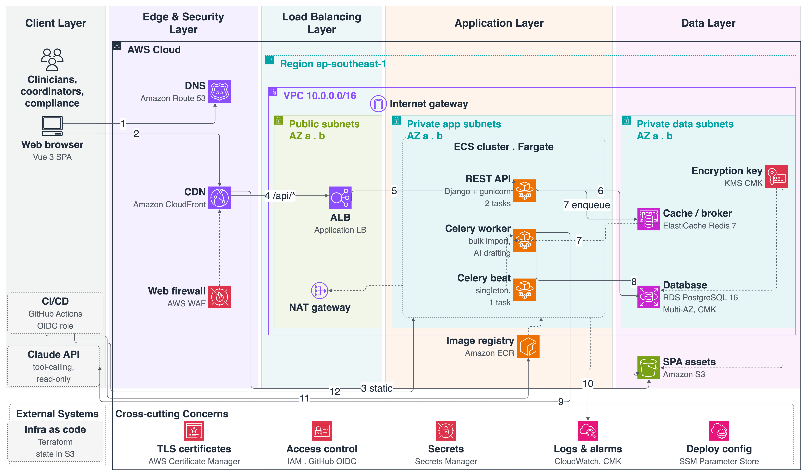

# CarePath — Clinical Care Coordination Platform

A portfolio project for a Senior Software Engineer role (Django + Vue 3, healthcare, large datasets, AI
agent workflows, regulatory processes). No product was specified in the job post — CarePath is the
product chosen to demonstrate all four in one coherent system.

- **Backend:** Python 3.12 · Django 5 · Django REST Framework · PostgreSQL 16 · Redis 7 · Celery 5
- **Frontend:** Vue 3 (Vite, TypeScript, `<script setup>`) · Pinia · SCSS design tokens
- **AI:** Claude (Anthropic), tool-calling into read-only selectors, mandatory human sign-off before any
  AI output reaches the legal record
- **Infra:** Docker / docker-compose locally · Terraform for AWS (ECS Fargate, RDS Multi-AZ-capable
  Postgres, customer-managed KMS)

> Status: built and verified end-to-end (backend, frontend, Docker Compose, Terraform validated).
> See [§16](docs/plan.md#16-implementation-notes-filled-in-duringafter-the-build) for what's
> actually built and verified vs. designed, including real bugs found during verification.

---

## Why Django + Vue 3, and why this product

The job post asks specifically for **Django**, **Vue 3**, **large datasets**, **AI agent workflows**, and
**complex regulatory processes**, with healthcare preferred. CarePath is a clinical care-coordination
tool built to exercise all five for real, not as separate toy demos:

- **Large datasets** → a 50k+ row patient search under 300 ms p95, and a bulk lab-result CSV importer
  that runs asynchronously and never loads the whole file into memory.
- **AI agent workflows** → a clinical documentation assistant that drafts a SOAP note using tool-calling
  into the patient's chart, but has **no tool that can write anything** — only a clinician's explicit
  approval action can turn a draft into part of the legal record.
- **Complex regulatory processes** → every PHI access is audited in the same database transaction as
  the access itself, access is scoped to a user's care team at the query level (not filtered after the
  fact), referrals are blocked without an active consent record, and an emergency "break-glass" override
  exists but is heavily logged and requires a reason.

The full reasoning — each requirement traced to a design standard traced to an architecture decision —
is in [`docs/plan.md` §2A](docs/plan.md#2a-requirements--design-standards--decisions).

This is the second project in this portfolio built the same way: see
[`../python-vuejs`](../python-vuejs) for the sibling real-estate project (FastAPI + Nuxt), built for a
different job post with different requirements (public SEO, multi-currency) — the two projects
deliberately make different architecture calls (SPA vs. SSR, Postgres vs. MySQL, Django vs. FastAPI)
because their requirements differ, not by default.

## Requirements

See [`docs/plan.md` §2A.1–§2A.2](docs/plan.md#2a1-functional-requirements-fr) for the full FR/NFR list.
Headlines: append-only signed clinical notes, care-team-scoped access enforced at the queryset level,
100% audit coverage of PHI access, AI drafts that cannot reach the record without clinician approval,
customer-managed encryption keys for anything holding PHI.

## Architecture

**Application:** Vue 3 SPA → Django REST Framework (`/api/v1`) → service layer (writes + audit) →
selector layer (care-team-scoped reads) → PostgreSQL, with Celery workers for bulk import and AI
drafting. See [`docs/plan.md` §4–§7](docs/plan.md#4-architecture).

**AWS deployment:** CloudFront + WAF → S3 (static SPA) and ALB → ECS Fargate (Django, Celery worker,
Celery beat) → RDS PostgreSQL (Multi-AZ-capable, customer-managed KMS key) and ElastiCache Redis, all in
private subnets. See [`docs/plan.md` §15](docs/plan.md#15-aws-deployment).



## Business flows

Six core flows as UML sequence diagrams (same generator pattern as the sibling project):

| Flow | Shows |
|---|---|
| [B1 Patient search](docs/architecture/flow_b1_patient_search.png) | Care-team scoping, keyset pagination, audited read |
| [B2 Encounter + AI draft + sign](docs/architecture/flow_b2_encounter_ai_draft.png) | Tool-calling, mandatory human approval, append-only note versioning |
| [B3 Referral with consent gate](docs/architecture/flow_b3_referral_consent.png) | 409 without active consent |
| [B4 Bulk lab import](docs/architecture/flow_b4_bulk_lab_import.png) | Async, chunked, idempotent |
| [B5 Break-glass access](docs/architecture/flow_b5_break_glass.png) | Denied without a reason, granted + audited with one |
| [B6 Compliance audit review](docs/architecture/flow_b6_audit_review.png) | Searchable, exportable audit log |

Full detail (requirements, rules shown, key steps) in
[`docs/plan.md` §7A](docs/plan.md#7a-business-flows-sequence-diagrams-generated).

## Getting started

Demo accounts (after seeding), password `Demo@1234`: `clinician@demo.com`, `coordinator@demo.com`,
`compliance@demo.com`.

```bash
cp .env.example .env
make up          # Postgres, Redis, Django API, Celery worker + beat, Vue SPA
make migrate
make seed        # demo care team, patients, a signed encounter, a pending AI draft
make test        # backend (pytest) + frontend (vitest)
```

- Web: <http://localhost:5173> (dev) or the built SPA served by the `frontend` container
- API docs (Swagger): <http://localhost:8000/api/v1/schema/swagger-ui/>

## Quality checks

```bash
make lint        # ruff + ESLint
make typecheck   # mypy (django-stubs) + vue-tsc
make test        # pytest (≥ 85 % coverage on services/selectors) + Vitest
```

## Deploying to AWS

Terraform modules and deploy scripts are in `infra/terraform/` and `scripts/aws/`, adapted from the
sibling project with the regulatory-driven differences in
[`docs/plan.md` §15.1](docs/plan.md#151-whats-different-from-the-real-estate-project-and-why) (Postgres,
Celery worker/beat as their own services, customer-managed KMS keys, no server-rendered frontend).

```bash
make aws-bootstrap
make infra-plan ENV=staging && make infra-apply ENV=staging
make deploy ENV=staging
```

## Project documents

- [`docs/plan.md`](docs/plan.md): scope, requirements, design, work breakdown, AI workflow, AWS deployment
- [`docs/architecture/`](docs/architecture/): generated AWS and business-flow diagrams
- [`docs/adr/`](docs/adr/): architecture decision records
