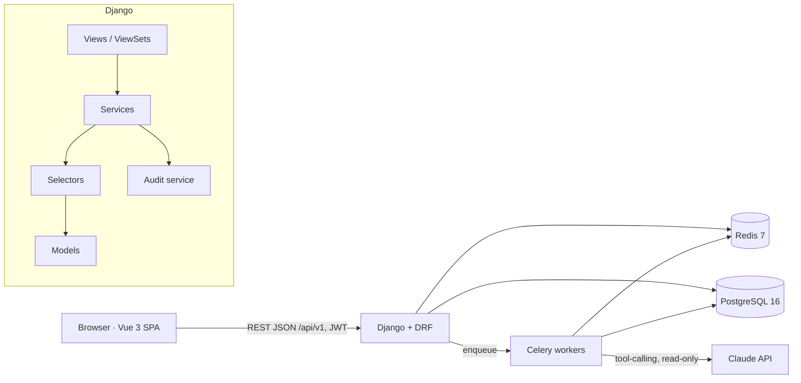
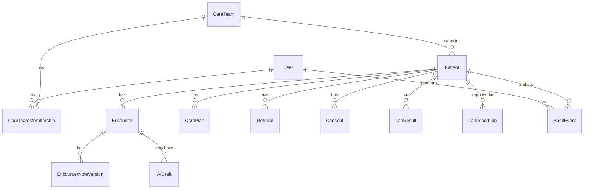
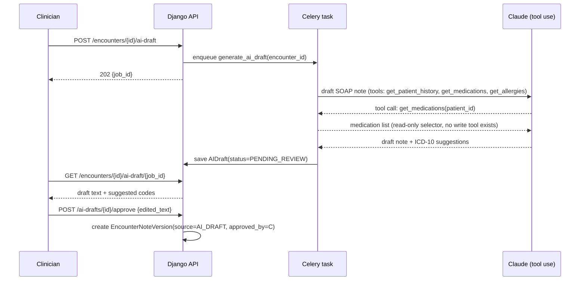
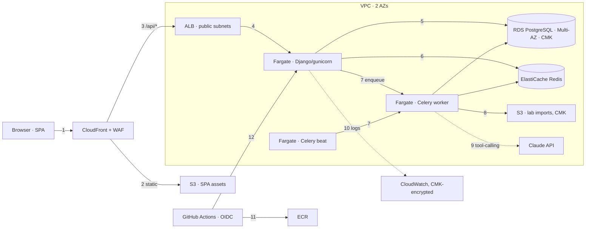

# CarePath — Clinical Care Coordination Platform

> Home assignment / portfolio project for a **Senior Software Engineer** role.
> Stack from the job post: **Python/Django backend, Vue 3 frontend, Claude Code workflows, manual code
> review, architecture design.** Preferred: healthcare experience, large datasets, AI agent workflows,
> complex regulatory processes, advanced CS background.
> This plan exists to show all four in one coherent, working system — not as separate toy demos.

No product was specified in the job post, only the kind of engineering the team does. **CarePath** is
the product chosen to demonstrate it: a platform where a clinical care team documents patient
encounters, coordinates referrals, and gets AI-drafted clinical summaries that a licensed clinician must
review and sign before anything becomes part of the legal record.

---

## 1. Goals of this assignment

| What the job post asks for | Where this plan shows it |
|---|---|
| Django backend | §6 — layered Django apps, service/selector pattern, DRF |
| Vue 3 frontend | §7 — Vue 3 SPA (Vite, Pinia, TypeScript) |
| Large datasets | §6.7 — bulk lab-result import via Celery, keyset pagination, indexed search over 100k+ rows |
| AI agent workflows | §6.8 — clinical documentation assistant, tool-calling, mandatory human sign-off |
| Complex regulatory processes | §2A.2 (NFR), §6.9 — HIPAA: audit trail, RBAC by care team, consent, break-glass access |
| Healthcare | the whole product |
| Advanced CS background | §2A — requirements traced to design standards to architecture, not vibes |
| Claude Code workflows / manual review | §11 — AI-assisted workflow, review checklist, Definition of Done |

**Main aim:** senior-level, defensible engineering — every architecture choice traces to a requirement,
every regulatory claim has a concrete mechanism (not just a mention of "HIPAA compliant"), and the code
is reviewable in small, clearly-scoped pieces.

---

## 2. Product scope (MVP)

### Personas

- **Clinician (MD/NP):** documents encounters, reviews AI-drafted notes, signs the legal record, creates
  care plans, requests referrals.
- **Care Coordinator:** manages the patient roster for their care team, tracks referrals and follow-ups,
  imports bulk lab results, does not write clinical notes.
- **Compliance Officer:** reviews the audit log, reviews break-glass access events, manages consent
  policy — read-only on clinical data, full access to audit data.
- **Patient:** out of scope for the MVP (no patient portal). Documented as a "next step" — every model
  is already shaped so a patient-facing read-only view is additive, not a rewrite.

### Features: in scope

| # | Feature | Notes |
|---|---|---|
| F1 | Authentication & RBAC | Role-based (Clinician / Coordinator / Compliance), scoped to care teams |
| F2 | Patient roster & search | Search/filter across a large roster, keyset-paginated |
| F3 | Patient chart | Demographics, problem list, allergies, medications, encounter history |
| F4 | Encounter documentation | Structured SOAP note, diagnosis codes (ICD-10), status workflow |
| F5 | AI clinical assistant | Drafts a SOAP summary + code suggestions from raw notes; clinician must approve or edit before signing |
| F6 | Care plans | Goals, tasks, target dates, assigned owner |
| F7 | Referrals | Referral to another provider/team; gated on an active consent record |
| F8 | Bulk lab-result import | CSV upload, async processing, per-row validation report, idempotent re-run |
| F9 | Audit log | Every read/write of PHI logged; compliance officer can search and export it |
| F10 | Consent management | Per-patient consent records with type, scope and expiry |
| F11 | Break-glass access | Emergency override outside normal care-team scope, requires a reason, heavily audited |

### Out of scope (documented as "next steps")

Patient portal, e-prescribing, billing/claims, HL7/FHIR interop, real ICD-10/CPT code databases (a
static seed list is used), multi-language, native mobile.

---

## 2A. Requirements → design standards → decisions

Same method as the real-estate project (`python-vuejs/docs/plan.md` §2A): **requirement → design
standard → decision**, so a reviewer can check that nothing was added "because it sounds enterprise."

### 2A.1 Functional requirements (FR)

See the table in §2 (F1–F11); each is an FR referenced below as FR-01 … FR-11 in that order.

### 2A.2 Non-functional requirements (NFR)

| ID | Quality | Requirement (measurable) |
|---|---|---|
| NFR-01 | Data integrity | Clinical notes are append-only once signed; an edit after signing creates a new version, never overwrites (medical-record legal defensibility) |
| NFR-02 | Access control | A user can only read/write a patient's PHI if they are on that patient's care team, or used break-glass with a logged reason — enforced at the query layer, not only in the UI |
| NFR-03 | Auditability | 100 % of PHI reads and writes produce an audit record (who, when, what, which patient, why for break-glass) within the same DB transaction as the action |
| NFR-04 | AI safety | No AI-generated clinical content reaches the legal record without an explicit clinician approval action; the AI draft and the approved version are both retained |
| NFR-05 | Scale (large datasets) | Patient search stays under 300 ms p95 at 200k patient rows; bulk import processes 50k rows without blocking the request/response cycle |
| NFR-06 | Availability | Production target 99.9 %: ≥ 2 tasks per service across 2 AZs, Multi-AZ database, zero-downtime deploys |
| NFR-07 | Encryption | PHI encrypted at rest (customer-managed KMS key, not the AWS-managed default — a compliance reviewer expects this) and in transit everywhere |
| NFR-08 | Maintainability | Django apps stay thin-view/fat-service; a new field on an existing model touches at most one app plus its serializer |
| NFR-09 | Testability | ≥ 85 % coverage on `services/` and `selectors/`; every permission rule has a unit test that asserts both the allow and the deny case |
| NFR-10 | Observability | Structured logs with a request id; `/health/` checks DB, cache and broker; Celery task failures alert |
| NFR-11 | Deployability | One command locally (`make up`); CI gate on tests, lint, type-check and migration-drift check before merge |
| NFR-12 | Retention | Audit records and signed clinical notes are never hard-deleted (soft delete + legal hold flag only) |
| NFR-13 | Cost | Staging environment ≈ USD 200–230/month (higher than a non-regulated app: Multi-AZ-capable sizing, customer-managed KMS, longer log retention) |

### 2A.3 Design standards (DS) derived from the requirements

| ID | Design standard | Derived from |
|---|---|---|
| DS-01 | **Thin views, fat services:** DRF views/viewsets only parse/validate/respond; business rules live in `app/services.py`, reads live in `app/selectors.py` | NFR-08, NFR-09 |
| DS-02 | **Care-team scoping at the queryset level:** every selector that returns PHI starts from `Patient.objects.for_user(user)`, never from `Patient.objects.all()` filtered later in Python | NFR-02 |
| DS-03 | **Append-only clinical documents:** `Encounter` notes are versioned rows (`EncounterNoteVersion`), signing freezes a version; nothing is destructively updated after signing | NFR-01, NFR-12 |
| DS-04 | **Audit as a transaction participant:** an `AuditEvent` row is written inside the same DB transaction as the PHI access it describes, via a service-layer helper, not a background job that could silently fail | NFR-03 |
| DS-05 | **AI output is data, not truth:** `AIDraft` rows are a separate, clearly-labelled model; a clinician action (`approve_draft`) is what creates the real `EncounterNoteVersion`, and both stay linked and retrievable | NFR-04 |
| DS-06 | **Bulk work is asynchronous and idempotent:** imports run as Celery tasks keyed by an idempotency key, report per-row results, and can be safely re-run on the same file | NFR-05, NFR-10 |
| DS-07 | **Keyset pagination for large lists:** patient/audit list endpoints paginate on `(created_at, id)`, never `OFFSET n` at scale | NFR-05 |
| DS-08 | **Explicit contracts:** DRF serializers are the only boundary; the SPA never receives a raw Django model dict | NFR-08 |
| DS-09 | **Encryption by default, customer-managed keys for PHI stores:** RDS, the S3 document bucket and the audit log use a CMK, not `aws/rds`/`aws/s3` defaults | NFR-07 |
| DS-10 | **Test pyramid weighted toward permissions:** every `selectors.py`/`services.py` function that touches PHI has an allow-case and a deny-case test | NFR-09 |
| DS-11 | **Soft delete + legal hold:** no `DELETE` on clinical or audit tables; a `deleted_at`/`legal_hold` pair controls visibility | NFR-01, NFR-12 |
| DS-12 | **Everything as code:** Docker, Terraform, CI/CD, diagrams generated from scripts (same convention as the real-estate project) | NFR-11 |

### 2A.4 Traceability: requirement → decision

| Decision | Why (FR/NFR → DS) |
|---|---|
| Django + DRF (not FastAPI) | The job post asks for Django specifically; Django's ORM + admin + migrations are a strong fit for an audited, regulated data model (DS-01) |
| PostgreSQL, not MySQL | JSONB for flexible clinical fields (e.g. SOAP sections), partial/expression indexes for RBAC-scoped queries, native row-level constraints — a better fit than the real-estate project's MySQL choice (NFR-05, DS-02) |
| Service/selector layer per app | DS-01, NFR-08 |
| `Patient.objects.for_user()` manager | DS-02, NFR-02 |
| `EncounterNoteVersion` instead of an editable `note` field | DS-03, NFR-01 |
| `AuditEvent` written via a `record_access()` service helper called from every selector/service that touches PHI | DS-04, NFR-03 |
| `AIDraft` model + `approve_draft` service action | DS-05, NFR-04 |
| Celery + Redis broker for bulk import | DS-06, NFR-05 |
| Cursor pagination class on patient/audit endpoints | DS-07, NFR-05 |
| Vue 3 SPA (Vite), not Nuxt SSR | Internal, authenticated clinical tool — no public SEO requirement, unlike the real-estate project; SSR would add cost with no benefit here |
| ECS Fargate + RDS Multi-AZ-capable + customer-managed KMS | NFR-06, NFR-07, DS-09 |

**How to use this in review:** each PR names the FR/NFR it serves and the DS it follows, exactly as in
the real-estate project. A change that breaks a DS needs an ADR.

---

## 3. Tech stack

| Layer | Choice | Why |
|---|---|---|
| Backend framework | Django 5, Django REST Framework | Required by the job post; DRF gives typed serializers and a browsable API for review |
| Database | PostgreSQL 16 | JSONB, partial indexes, `SELECT … FOR UPDATE` semantics used by the audit/consent logic |
| Cache / broker | Redis 7 | Cache-aside for lookups, Celery broker/result backend |
| Background jobs | Celery 5 + Celery Beat | Bulk import, AI draft generation (kept off the request/response cycle), scheduled break-glass digest |
| Auth | DRF SimpleJWT (access + refresh), custom RBAC | Stateless API; refresh rotation mirrors the real-estate project's pattern |
| AI provider | Anthropic Claude via the Messages API, tool use | Tool-calling into read-only selectors (patient history, meds, allergies); never given write access |
| Tests | pytest, pytest-django, factory pattern, `freezegun` for audit timestamps | |
| Quality | ruff, mypy (django-stubs), pre-commit | |
| Frontend | Vue 3, `<script setup>` + TypeScript, Vite | SPA, no SSR needed |
| State | Pinia | |
| Routing | Vue Router (auth guards mirror role, not just login state) | |
| Styling | SCSS design tokens (same method as the real-estate project) | |
| FE tests | Vitest + @vue/test-utils | |
| API types | `openapi-typescript` from DRF's generated schema (`drf-spectacular`) | Same drift-proofing pattern as the real-estate project |
| Infra | Docker, docker-compose, Terraform, GitHub Actions CI | |

---

## 4. Architecture



**Request flow:** `ViewSet` (HTTP only) → `service` (business rule + audit) → `selector` (read, always
care-team scoped) → model. Serializers are the only objects that cross the HTTP boundary.

---

## 5. Project structure

Top-level repository layout, same convention as the real-estate project's §5:

```
python-vuejs-2/
├── README.md
├── docker-compose.yml
├── Makefile                        # make up / down / migrate / seed / test / lint / typecheck / deploy …
├── .env.example
├── .github/workflows/
│   ├── ci.yml                      # lint + type-check + migration-drift check + tests on every PR
│   └── deploy.yml                  # push to master → staging, tag v* → production
├── docs/
│   ├── plan.md                     # this file
│   ├── adr/                        # Architecture Decision Records
│   ├── architecture/               # AWS + business-flow diagrams, generated (gen_*.py → .drawio → .png)
│   └── screenshots/
├── infra/terraform/                # AWS infra as code — staging/prod envs + modules (§15.6)
├── scripts/aws/                    # deploy / migrate / rollback scripts (adapted from python-vuejs)
├── backend/                        # Django project — full tree below
└── frontend/                       # Vue 3 SPA — full tree below
```

**`backend/` in full** (each domain app under `apps/` has the same five files + `tests/`; see §6.1 for
what each file is responsible for):

```
backend/
├── Dockerfile
├── pyproject.toml                  # ruff, mypy, pytest, coverage config
├── manage.py
├── config/
│   ├── settings/{base.py,local.py,test.py,production.py}
│   ├── urls.py                     # mounts every app's urls.py under /api/v1
│   ├── celery.py
│   ├── asgi.py / wsgi.py
│   └── __init__.py
├── apps/
│   ├── common/          {enums.py, constants.py, models.py, pagination.py, rendering.py,
│   │                     exceptions.py, request_context.py, middleware.py, permissions.py,
│   │                     views.py (health check), urls.py, tests/}
│   ├── accounts/        {models.py (User, CareTeam, CareTeamMembership), managers.py,
│   │                     serializers.py, views.py (JWT auth), urls.py, admin.py, tests/}
│   ├── audit/            {models.py (AuditEvent), services.py (record_access), selectors.py,
│   │                     serializers.py, views.py, urls.py, admin.py, tests/}
│   ├── patients/        {models.py (Patient, Allergy, Medication, Consent), selectors.py,
│   │                     services.py, serializers.py, views.py, urls.py, admin.py, tests/}
│   ├── encounters/      {models.py (Encounter, EncounterNoteVersion, DiagnosisCode), selectors.py,
│   │                     services.py (sign_note), serializers.py, views.py, urls.py, tests/}
│   ├── care_plans/      {models.py, selectors.py, serializers.py, views.py, urls.py, tests/}
│   ├── referrals/       {models.py, services.py (consent gate), selectors.py, serializers.py,
│   │                     views.py, urls.py, tests/}
│   ├── lab_results/     {models.py (LabResult, LabImportJob), services.py, tasks.py (Celery),
│   │                     serializers.py, views.py, urls.py, tests/}
│   └── ai_assistant/    {models.py (AIDraft), providers.py (LLM strategy), tools.py (read-only
│   │                     tool set), services.py (approve_draft), tasks.py, serializers.py,
│   │                     views.py, urls.py, tests/}
└── tests/                          # cross-app integration tests only; per-app unit tests live in each app
```

**`frontend/` in full:** see §7.3 (mirrors this same level of detail for the Vue 3 SPA).

---

## 6. Backend design (Django)

### 6.1 Folder structure

```
backend/
├── Dockerfile
├── pyproject.toml
├── manage.py
├── config/                         # Django project package
│   ├── settings/{base.py,local.py,test.py,production.py}
│   ├── urls.py
│   ├── celery.py
│   └── asgi.py / wsgi.py
├── apps/
│   ├── common/                     # enums, pagination, permissions base, audit mixins
│   ├── accounts/                   # User, Role, CareTeam, CareTeamMembership
│   ├── patients/                   # Patient, Allergy, Medication, Consent
│   ├── encounters/                 # Encounter, EncounterNoteVersion, DiagnosisCode
│   ├── care_plans/                 # CarePlan, CarePlanTask
│   ├── referrals/                  # Referral
│   ├── lab_results/                # LabResult, LabImportJob (Celery)
│   ├── ai_assistant/                # AIDraft, Claude client, tool definitions
│   └── audit/                      # AuditEvent, BreakGlassEvent, compliance views
└── tests/                          # cross-app integration tests (per-app unit tests live in each app)
```

Each domain app has: `models.py`, `selectors.py` (reads), `services.py` (writes + side effects),
`serializers.py`, `views.py` (thin), `permissions.py`, `urls.py`, `tests/`.

### 6.2 Design patterns

| Pattern | Where | Purpose |
|---|---|---|
| Service/selector layer | every app | DS-01 — business logic out of views and models |
| Custom manager (`for_user`) | `Patient`, `Encounter` | DS-02 — RBAC enforced at the query, not after |
| Append-only versioning | `EncounterNoteVersion` | DS-03 |
| Unit of Work (Django's `transaction.atomic`) | `services.py` write paths | audit + write happen together or not at all |
| Strategy | `ai_assistant/providers.py` — swappable LLM provider behind one interface | keeps `ai_assistant` app testable without a real API key |
| Adapter/serializer | DRF serializers | DS-08 |
| Specification-style filters | `patients/filters.py` (django-filter) | composable search, same idea as the real-estate `PropertyFilter` |
| Observer via signals, avoided | audit uses an explicit service call, **not** a `post_save` signal | a signal can be bypassed by `bulk_update`/raw SQL; an explicit call inside the same transaction cannot (DS-04) |

### 6.3 Enums (`apps/common/enums.py`)

All are `models.TextChoices`, stored as strings in Postgres and mirrored in the frontend (§7.3).

```python
class Role(models.TextChoices):        CLINICIAN, CARE_COORDINATOR, COMPLIANCE_OFFICER
class EncounterStatus(models.TextChoices): DRAFT, PENDING_SIGNATURE, SIGNED, AMENDED
class NoteSource(models.TextChoices):  CLINICIAN, AI_DRAFT
class ReferralStatus(models.TextChoices): REQUESTED, ACCEPTED, DECLINED, COMPLETED
class ConsentType(models.TextChoices): TREATMENT, DATA_SHARING, RESEARCH
class ImportJobStatus(models.TextChoices): PENDING, RUNNING, SUCCEEDED, FAILED_PARTIAL
class AuditAction(models.TextChoices): READ, CREATE, UPDATE, EXPORT, BREAK_GLASS
class AIDraftStatus(models.TextChoices): PENDING, READY, APPROVED, FAILED
```

### 6.4 Constants (`apps/common/constants.py`)

Same discipline as the real-estate project's `app/common/constants.py`: every limit, TTL and timeout
gets one named constant here, never a bare number in a view/service/serializer.

```python
API_V1_PREFIX = "/api/v1"
DEFAULT_PAGE_SIZE = 25
MAX_PAGE_SIZE = 100
ACCESS_TOKEN_TTL_MINUTES = 15
REFRESH_TOKEN_TTL_DAYS = 7
LAB_IMPORT_CHUNK_SIZE = 500          # rows per bulk_create batch (§6.8)
AI_DRAFT_MAX_TOOL_LOOPS = 6          # bounded agent loop; a runaway chain must not hang a worker
BREAK_GLASS_MIN_REASON_LENGTH = 10   # characters; rejects a rubber-stamp "n/a"
AUDIT_DIGEST_HOUR_UTC = 6            # daily break-glass digest to compliance (Celery Beat)
```

Secrets and per-environment values (`SECRET_KEY`, `ANTHROPIC_API_KEY`, DB/Redis host) live only in
`.env` → `config/settings/*.py`, never here — same separation as the real-estate project.

### 6.5 Data model (PostgreSQL)



| Table | Key columns |
|---|---|
| `accounts_user` | id, email (unique), hashed_password, first_name, last_name, role, is_active, is_staff, created_at, updated_at |
| `accounts_careteam` | id, name (unique), created_at, updated_at |
| `accounts_careteammembership` | id, care_team_id, user_id (unique together), created_at, updated_at |
| `patients_patient` | id, mrn (unique), first_name, last_name, date_of_birth, care_team_id, deleted_at, legal_hold, created_at, updated_at |
| `patients_allergy` | id, patient_id, substance, reaction, severity |
| `patients_medication` | id, patient_id, name, dosage, frequency, active |
| `patients_consent` | id, patient_id, consent_type, granted_at, revoked_at (one active row per type, enforced by a partial unique constraint) |
| `encounters_encounter` | id, patient_id, clinician_id, status, reason, occurred_at, created_at |
| `encounters_encounternoteversion` | id, encounter_id, version, source, content, signed_by_id (null until signed), signed_at (null until signed, then immutable), supersedes_id |
| `encounters_diagnosiscode` | id, encounter_id, code, description |
| `care_plans_careplan` | id, patient_id, title, goal |
| `care_plans_careplantask` | id, care_plan_id, description, due_date, completed_at |
| `referrals_referral` | id, patient_id, referring_clinician_id, specialty, reason, status |
| `lab_results_labresult` | id, patient_id, test_name, value, unit, observed_at |
| `lab_results_labimportjob` | id, uploaded_by_id, idempotency_key (unique, SHA-256 of file), status, total_rows, imported_rows, error_report (JSON) |
| `ai_assistant_aidraft` | id, encounter_id, requested_by_id, status, content, model_name, tool_calls (JSON), error |
| `audit_auditevent` | id, actor_id, action, resource_type, resource_id, patient_id (indexed), reason, is_break_glass, metadata (JSON), created_at (indexed) |

**Indexes:** `patient(last_name, first_name)` and `patient(mrn)` for roster search (a trigram index is
added when search moves past prefix/substring match at scale); `auditevent(resource_type, resource_id)`
and `auditevent(actor_id, -created_at)` for the compliance search screen (B6).
Dates of birth and every free-text clinical field stay outside any cache (§6.10).

### 6.6 REST API (`/api/v1`) — representative endpoints

| Method | Path | Auth | Notes |
|---|---|---|---|
| POST | `/auth/login`, `/auth/refresh`, `/auth/logout` | – | same JWT pattern as the real-estate project |
| GET | `/patients` | care-team scoped | search + keyset pagination (DS-07) |
| GET | `/patients/{mrn}` | care-team scoped, audited READ | 403 if not on the care team and no break-glass header |
| POST | `/patients/{id}/break-glass` | any clinician | requires `reason`; logs `AuditAction.BREAK_GLASS`, grants a short-lived scoped token |
| POST | `/encounters` | clinician | creates a `DRAFT` encounter |
| POST | `/encounters/{id}/ai-draft` | clinician | enqueues a Celery task, returns a job id |
| GET | `/encounters/{id}/ai-draft/{job_id}` | clinician | poll for the `AIDraft` result |
| POST | `/encounters/{id}/sign` | clinician | freezes the current note version (DS-03) |
| POST | `/referrals` | care coordinator/clinician | 409 if no active `Consent` of type `DATA_SHARING` |
| POST | `/lab-imports` | care coordinator | multipart CSV, returns an `ImportJob` id |
| GET | `/lab-imports/{id}` | care coordinator | progress + per-row error report |
| GET | `/audit-events` | compliance officer only | filter by patient, user, action, date range |
| GET | `/health` | – | DB + Redis + Celery broker |

**Response envelope:** same `{"data": …}` / `{"data": [...], "meta": {...}}` / `{"error": {...}}` shape as
the real-estate project, produced by a shared DRF exception handler and renderer.

### 6.7 RBAC + care-team scoping (NFR-02, DS-02)

```python
class PatientQuerySet(models.QuerySet):
    def for_user(self, user: User) -> "PatientQuerySet":
        if user.role == Role.COMPLIANCE_OFFICER:
            return self.none()  # compliance sees audit data, not clinical data, by default
        return self.filter(care_team__memberships__user=user).distinct()
```

Every selector starts here. A view that needs a single patient calls
`selectors.get_patient_or_404(user, mrn)`, which raises `Http404` (not 403) for out-of-scope patients —
a regulated system should not reveal *that a patient exists* to someone outside their care team.

### 6.8 Large datasets (NFR-05, DS-06, DS-07)

- **Search:** `Patient` indexed on `(care_team_id, last_name, first_name)` and a trigram index on name
  for partial match; keyset pagination cursor is `(last_name, id)`.
- **Bulk import:** CSV uploaded to S3, a Celery task streams it row by row (never loads the whole file
  into memory), validates each row, `bulk_create`s in chunks of `LAB_IMPORT_CHUNK_SIZE` (§6.4), and
  writes one `LabImportJob` row with a JSON error report per failed row. Idempotency key = SHA-256 of
  the file, so re-uploading the same file is a no-op, not a duplicate import.

### 6.9 AI clinical assistant (DS-05, NFR-04)



Rules enforced in code, not policy text: the LLM is given **no tool that writes anything**; the only
path from an `AIDraft` to the legal record is `services.approve_draft(user, draft, edited_text)`, which
requires the caller to be a clinician on the patient's care team and always creates a new
`EncounterNoteVersion` (never edits the draft in place, so the original AI output stays auditable next
to what the clinician actually signed).

### 6.10 Regulatory mechanisms (HIPAA-aligned, NFR-02/03/04/07/12)

| Requirement | Concrete mechanism | Not just… |
|---|---|---|
| Minimum necessary access | `for_user()` queryset scoping (§6.7) | …a note in the README |
| Audit trail | `AuditEvent` row per PHI access, same transaction (DS-04) | …application logs someone might not read |
| Break-glass | `/patients/{id}/break-glass` endpoint, mandatory reason, separate audit action, daily digest emailed to compliance | …an admin flag nobody checks |
| Consent gate | `Referral` creation checks for an active `Consent(type=DATA_SHARING)` row | …a checkbox with no backend check |
| Legal record integrity | Append-only `EncounterNoteVersion`, soft delete only (DS-11) | …`updated_at` on a mutable row |
| Encryption | Customer-managed KMS key for RDS + S3 (§15.4) | …"encryption enabled" with the default AWS key |

### 6.11 Redis usage — and why PHI is deliberately *not* cached

Unlike the real-estate project's cache-aside-everywhere approach, Redis here is scoped narrower on
purpose:

1. **Celery broker + result backend** — bulk import and AI-draft generation (§6.8, §6.9). This is the
   primary use.
2. **JWT refresh-token blacklist** (`rest_framework_simplejwt.token_blacklist`) — revocation on logout
   and rotation, same idea as the real-estate project's `auth:revoked:{jti}` key, implemented here as a
   DB-backed table instead of a Redis key so a blacklist entry survives a Redis restart (a stricter
   choice than the real-estate project's, justified by NFR-03's audit expectations).
3. **No cache-aside on patient/chart data.** The real-estate project caches property reads because a
   stale read is a cosmetic problem; here, every PHI read must produce exactly one `AuditEvent` row
   (NFR-03) and must reflect care-team membership *at the moment of the request* (NFR-02) — a cached
   response would need its own invalidation-on-care-team-change logic and would still need an audit
   write on every cache hit, which removes the whole point of caching. Non-PHI lookups (specialty list
   for referrals, ICD-10 seed codes) are small and static enough to ship as a frontend constant instead
   of a cached endpoint, so this trade-off costs nothing in practice.

### 6.12 Backend code standard (naming, interfaces, model conventions)

The symmetric counterpart to §7.7's frontend standard — this is what "the model/interface layer is
explicit" means in this codebase, concretely, not as a slogan:

- **Function signatures are the interface.** Every `selectors.py`/`services.py` function takes
  **keyword-only arguments** (`def get_patient_chart(*, user: User, patient_id: int, ...)`) and a
  **type hint on every parameter and return value** — no `**kwargs`, no positional args beyond `self`.
  A reviewer reads the signature and knows the full contract without opening the body.
- **Naming verbs are fixed and mean one thing each**, consistently across every app:
  - `get_*` → returns one object or `None` (never raises for "not found" at the selector layer — the
    service layer decides whether "not found" becomes 404 or a break-glass path, per `patients/services.py`)
  - `list_*` → returns a `QuerySet` (never a materialized `list`, so the view's pagination class stays
    in control of when the query executes)
  - `create_*` / `sign_*` / `approve_*` / `request_*` → a service function that writes, always wrapped in
    `@transaction.atomic` or an explicit `with transaction.atomic():` block, always returns the created/
    mutated model instance (never a dict, never `None` on success)
- **Selectors never raise; services raise typed exceptions.** A selector answers a data question. A
  service enforces a rule, and enforces it by raising a subclass of `apps.common.exceptions.AppError`
  (e.g. `PatientAccessDeniedError`, `ConsentRequiredError`, `InvalidSignError`, `DraftNotReadyError`) —
  never a bare `Exception`, never an inline `Response(..., status=...)` from inside a service. The one
  place HTTP status codes get decided is the `AppError.status_code` class attribute, so
  `api_exception_handler` (§6.6) is the only place that turns a domain error into an HTTP response.
- **No dict-shaped services.** A service returns a Django model instance or raises — it never returns a
  plain `dict`/`tuple`-of-mixed-types "for convenience." The one narrow exception already in the
  codebase, `start_import_job()` returning `(job, created)`, is a real two-part result (which the caller
  must branch on), not a stand-in for a proper return type.
- **Serializers are the only HTTP-facing shape.** A view never returns `model_to_dict()` or hand-built
  JSON; every response body is built by a DRF serializer, and a serializer's `fields` list is explicit
  (never `fields = "__all__"`) so adding a column to a model cannot silently start exposing it over the API.
- **Models stay declarative.** `models.py` holds fields, `Meta`, `__str__`, and only trivial derived
  properties (`get_full_name()`, `is_active()`, `compute_idempotency_key()` — pure functions of the
  instance's own fields, no DB access). Anything that queries related objects or has a branch on business
  state belongs in `selectors.py`/`services.py`, not on the model.
- **Shared model behaviour is a mixin, not copy-paste:** `TimestampedModel` (`created_at`/`updated_at`)
  and `SoftDeleteModel` (`deleted_at`/`legal_hold`, DS-11) in `apps/common/models.py` are the only two
  abstract base classes in the codebase — a new one needs a concrete reason, not "might be reusable."
- **Custom querysets carry the scoping rule, not the view.** `PatientQuerySet.for_user()` (§6.7) is the
  pattern every RBAC-scoped model follows: the rule lives on the queryset class next to the model it
  scopes, `as_manager()`'d onto `objects`, so `Model.objects.for_user(user)` is the only spelling a
  selector ever needs — a view/service can never accidentally bypass it by calling `.objects.all()`.
- **App-level naming:** Django app label = folder name = `INSTALLED_APPS` entry's last segment
  (`apps.patients` → label `patients`); `AppConfig` subclass name is `<PascalCase(app)>Config`
  (`PatientsConfig`); every app that exposes model admin registers it in that app's own `admin.py`, never
  centrally.

---

## 7. Frontend design (Vue 3 SPA)

### 7.1 Why an SPA, not SSR

CarePath is an authenticated internal clinical tool. There is no public page that needs to rank on
Google (unlike the real-estate project). SSR would add infrastructure cost and complexity — a Nuxt
server to run and scale — for zero benefit here, so a Vite-built SPA behind the same auth-gated API is
the right call and is called out explicitly in §2A.4 as a deliberate difference from the sibling project.

### 7.2 Pages (routes)

| Route | Who | Content |
|---|---|---|
| `/login` | – | JWT login |
| `/patients` | Clinician, Coordinator | Roster, search, filters |
| `/patients/:mrn` | care-team scoped | Chart: demographics, problem list, encounters, care plans, referrals |
| `/patients/:mrn/encounters/new` | Clinician | Encounter form, "Draft with AI" action |
| `/patients/:mrn/encounters/:id` | Clinician | Review AI draft / write note, sign |
| `/care-plans/:id` | Clinician, Coordinator | Goals & tasks |
| `/referrals` | Coordinator, Clinician | Referral queue, consent status |
| `/lab-imports` | Coordinator | Upload CSV, job progress, error report |
| `/audit` | Compliance officer only | Searchable audit log, break-glass digest |
| `error.vue` route | – | 403/404 |

### 7.3 Folder structure

```
frontend/
├── src/
│   ├── main.ts, App.vue, router/
│   ├── assets/styles/{_tokens.scss,_mixins.scss,main.scss}
│   ├── constants/{api.ts,routes.ts,colors.ts,app.ts}
│   ├── enums/                     # generated from the DRF/OpenAPI schema, same pattern as real-estate
│   ├── types/{api.generated.ts,models.ts}
│   ├── services/{http.ts,patient.service.ts,encounter.service.ts,ai.service.ts,audit.service.ts,…}
│   ├── stores/{auth.store.ts,patient.store.ts,ui.store.ts}    # ui.store: sidebar collapsed/expanded only
│   ├── composables/{usePatientSearch.ts,usePolling.ts,useStatusColor.ts,…}
│   ├── components/
│   │   ├── base/                  # BaseButton, BaseInput, BaseSelect, BaseBadge, BaseModal, BaseTable,
│   │   │                          # BasePagination, BaseSkeleton, BaseStatCard (§7.5)
│   │   ├── layout/                # AppSidebar, AppTopbar, AppBreadcrumb, PageHeader
│   │   ├── patient/                # PatientRosterTable, PatientCard, PatientChartHeader
│   │   ├── encounter/              # EncounterForm, AiDraftPanel, SignDiffViewer (§7.6)
│   │   └── audit/                  # AuditEventTable, AuditFilters
│   ├── views/                     # one per route
│   └── router/guards.ts           # role-based, not just "logged in"
└── tests/
```

### 7.4 Patterns

Same discipline as the real-estate project: container/presentational split, a typed service layer (no
component calls `fetch`/`axios` directly), Pinia only for genuinely cross-page state (auth, current
patient, sidebar UI state), enums + a colour-token map for status badges (`EncounterStatus`,
`ReferralStatus`, `ImportJobStatus`, `AIDraftStatus`) so no component hard-codes a status string or a hex
colour.

### 7.5 Visual design system (layout reference: Iqonic XRay clinical admin template)

The job post's product is an internal clinical tool, not a marketing site, so the visual reference is a
data-dense **admin dashboard**, not the real-estate project's marketing-site reference (Sheltos). Pattern
borrowed from <https://templates.iqonic.design/xray-dist/html/dashboard-pages/dashboard-1.html> (a
Bootstrap-based hospital admin theme): **fixed left sidebar + topbar shell**, stat cards summarizing key
numbers, data tables with inline action icons, and status pill badges — the layout language of the
convention, not its HTML/CSS or any of its assets, which are not used.

**Shell layout:**

```
┌─────────────┬──────────────────────────────────────────────┐
│             │  Topbar: breadcrumb · role badge · user menu  │
│  Sidebar    ├──────────────────────────────────────────────┤
│  (fixed,    │  PageHeader: title + primary action button    │
│  collapsible│──────────────────────────────────────────────│
│  icon+label)│  Content: stat cards row (optional) → main    │
│             │  panel (table / form / chart)                 │
└─────────────┴──────────────────────────────────────────────┘
```

- **Sidebar:** grouped nav (Patients, Encounters, Care Plans, Referrals, Lab Imports, Audit — the last
  shown only to `COMPLIANCE_OFFICER`), collapses to icon-only under 992 px, active-route highlight.
- **Topbar:** breadcrumb (auto-derived from the route meta, never hand-typed per view), current role as
  a badge next to the user menu — a clinician should never be confused about which role they're acting
  as, especially before a break-glass action.
- **PageHeader:** every view starts with one — page title + one primary action (e.g. "New Encounter"),
  no page invents its own header layout.
- **Stat cards** (`BaseStatCard`): used on `/patients` (roster count, care team count) and `/audit`
  (events today, break-glass events this week) — large number, label, small icon, never more than 4 per
  row.
- **Tables** (`BaseTable`): zebra-free, generous row height (clinical data needs to be scannable, not
  dense), inline icon actions (view/edit) instead of a separate "Actions" text column, empty/loading/error
  states required on every instance (no bare `v-if="data.length"` with nothing for the empty case).
- **Status pills:** one colour-token map per enum (`STATUS_COLOR[EncounterStatus.SIGNED]`, etc.), never
  an inline `style="color: green"`.

**Design tokens** (`assets/styles/_tokens.scss`) — a calmer, clinical palette, deliberately distinct from
the real-estate project's warm orange marketing palette:

```scss
$color-primary:        #2f6690;  // sidebar active state, primary buttons — calm clinical blue, not alarm-coded
$color-primary-dark:   #244f70;
$color-secondary:      #16324f;  // sidebar background, headings
$color-accent:         #3a8891;  // teal, secondary actions
$color-success:        #2e9e6c;  // SIGNED, ACCEPTED, SUCCEEDED
$color-warning:        #d98e04;  // DRAFT, PENDING, REQUESTED
$color-danger:         #c0392b;  // FAILED, DECLINED, break-glass indicator
$color-info:           #4a90c4;  // PENDING_SIGNATURE, RUNNING
$color-text:           #2b333b;
$color-text-muted:     #6b7680;
$color-border:         #e3e7ea;
$color-bg:             #ffffff;
$color-bg-soft:        #f4f6f8;  // content area background behind cards
$radius-sm: 4px; $radius-md: 8px; $radius-lg: 14px;
$shadow-card: 0 2px 10px rgba(22, 50, 79, .06);
$control-height: 42px;           // lesson carried over from the real-estate project: input/select must match exactly
$sidebar-width: 260px; $sidebar-width-collapsed: 72px; $topbar-height: 64px;
$font-family: 'Inter', 'Segoe UI', sans-serif;   // a plain, highly-legible data-table font — not a display font
```

`STATUS_COLOR` maps live in `constants/colors.ts` on the TS side, sourced from the same values, exactly
as the real-estate project keeps `_tokens.scss` and `constants/colors.ts` in sync by convention (checked
in code review, §9).

Responsive: sidebar collapses to icon rail under 992px and to an overlay drawer under 768px; tables
scroll horizontally in their own container rather than the page scrolling sideways (same rule as the
Artifact responsiveness convention used elsewhere in this workflow). Accessibility: AA contrast on every
token pair above, semantic table markup (`<th scope="col">`), focus-visible outline on every interactive
element — no `outline: none` without a replacement.

### 7.6 The one UI safety rule worth calling out

The AI draft review screen never lets a clinician "sign" without the diff between the AI draft and the
edited/approved text being visible on screen at the moment of signing — a direct UI expression of DS-05,
implemented as `SignDiffViewer` (a dumb, presentational component: two text blocks plus a computed diff,
no fetching of its own).

### 7.7 Frontend code standard

- **Components:** PascalCase filenames matching the component name; a component under 150 lines of
  template+script or it gets split; props always typed with `defineProps<{...}>()`, never a runtime
  `props: {...}` object; no component reaches into `localStorage`/`sessionStorage` directly — that goes
  through a composable.
- **Composables:** `use` prefix, return a plain object of refs/computed/functions, one responsibility per
  composable (`usePatientSearch` does not also handle pagination — that's `usePagination`, composed).
  A composable is a code unit, not a lifecycle shortcut: it does not assume it is only ever called from
  `setup()`.
- **Services:** one file per resource (`patient.service.ts`, `encounter.service.ts`, …), each function
  returns a typed model (mapped from `types/api.generated.ts`), never the raw `AxiosResponse`/`Response`.
  A view or component never imports `fetch`/`axios` directly.
- **Stores (Pinia):** only for state that is genuinely shared across routes (`auth`, current patient
  context, sidebar collapsed state). Per-view local state stays in the view with `ref`/`reactive` — a
  store per view is a smell, not a pattern.
- **Styling:** every colour, spacing and radius value comes from `_tokens.scss`; a component-scoped
  `<style>` block may only introduce layout-specific rules (flex/grid, one-off spacing between that
  component's own children), never a new colour or font-size.
- **Enums/status logic:** a component never compares a status string literal (`if (status === 'SIGNED')`)
  — it imports the enum. A new status value is a one-file change (`enums/` + the colour map), never a
  grep-and-replace across components.
- **Tests:** every base component gets a render test (props → expected DOM), every composable with
  branching logic gets a unit test, and `SignDiffViewer` specifically gets a test asserting the sign
  button is disabled/absent until a diff is rendered (this is the one test in the suite that directly
  protects DS-05 on the frontend).

---

## 7A. Business flows (sequence diagrams, generated)

Same style and tool as the real-estate project (`docs/diagrams` generator pattern): UML sequence
diagrams, one per core flow, generated from `docs/architecture/gen_business_flows.py`.

| Flow | Requirements | Shows |
|---|---|---|
| B1 Patient search (care-team scoped) | FR-02, NFR-02, NFR-05 | `for_user()` scoping, keyset pagination, audit READ |
| B2 Encounter + AI draft + sign | FR-04, FR-05, NFR-04 | The full §6.9 sequence, ending in an immutable `EncounterNoteVersion` |
| B3 Referral with consent gate | FR-07 | 409 when no active consent; success path writes an audit event |
| B4 Bulk lab import | FR-08, NFR-05 | Upload → Celery → chunked validation → per-row report |
| B5 Break-glass access | FR-11, NFR-02, NFR-03 | Denied without reason, granted + heavily audited with one |
| B6 Compliance audit review | FR-09 | Compliance officer queries `AuditEvent`, exports a filtered range |

---

## 8. Docker & local development

`docker-compose.yml` services: `postgres`, `redis`, `backend` (gunicorn, runs migrations on start),
`celery-worker`, `celery-beat`, `frontend` (nginx serving the Vite build).

```bash
cp .env.example .env
make up          # build + start everything
make migrate      # django-admin migrate
make seed         # demo care teams, patients, a signed encounter, one pending AI draft
make test         # backend (pytest) + frontend (vitest)
```

Demo accounts: `clinician@demo.com`, `coordinator@demo.com`, `compliance@demo.com` /
`Demo@1234`. API docs at `/api/v1/schema/swagger-ui/` (drf-spectacular).

---

## 9. Code quality & conventions

- **Python:** ruff (lint + format), mypy strict with `django-stubs`/`djangorestframework-stubs`, type
  hints everywhere, no business logic in `views.py` or `models.py` beyond simple derived properties
  (`get_full_name()`, `is_active()`), services always wrap writes in `transaction.atomic`, no bare
  `except Exception` without a comment explaining why that specific call must degrade instead of raise
  (the two accepted cases in this codebase: per-row CSV import errors, §6.8; AI drafting failures, §6.9).
- **TypeScript/Vue:** `strict: true`, `<script setup lang="ts">`, typed `defineProps`/`defineEmits`, no
  `any`, enums generated from the OpenAPI schema not hand-written, PascalCase component names, `use*`
  prefix for composables (see §7.7 for the full frontend standard).
- **Naming:** snake_case (Python: fields, functions, modules), camelCase (TypeScript), PascalCase (Python
  classes, Vue components), UPPER_SNAKE_CASE (constants, both languages), Django app labels stay singular
  where the domain concept is singular (`accounts`, `patients` are plural because they're collections;
  `audit` stays singular — it's a capability, not a row collection).
- **Git:** Conventional Commits (`feat(patients): add mrn search`), one ticket per PR, pre-commit hooks
  (ruff, `manage.py makemigrations --check`).
- **CI (GitHub Actions):** lint → type-check → migration-drift check (`makemigrations --check --dry-run`)
  → tests (pytest against a real Postgres/Redis service container, Vitest) → docker build.

---

## 10. Work breakdown (small tickets)

Each ticket is sized for about ½–1 day, same convention as the real-estate project's §10.

### Phase 0: Foundation (Day 1)
- **T0.1** Django project, settings split (`base`/`local`/`test`/`production`), `.env.example`, Docker,
  `/health` (DB + Redis) — *AC: `make up` gives healthy `postgres`, `redis`, `backend` containers.*
- **T0.2** Error envelope (`ApiEnvelopeRenderer`) + DRF exception handler (`api_exception_handler`) —
  *AC: an unhandled 500, a DRF `ValidationError`, and a raised `AppError` subclass all return the same
  `{"error": {code, message, details, request_id}}` shape.*
- **T0.3** `RequestIdMiddleware` + structured logging, CI pipeline + pre-commit.

### Phase 1: Accounts, RBAC, audit (Day 2)
- **T1.1** `User` (custom, email-based), `Role`, `CareTeam`, `CareTeamMembership`, JWT auth
  (login/refresh/me) — *AC: token payload carries `role`; a disabled user cannot obtain a token.*
- **T1.2** `AuditEvent` model + `record_access()` service helper, asserting it must run inside an open
  transaction — *AC: calling it outside `atomic()` raises immediately in tests; every PHI-selector call
  exercised in tests produces exactly one audit row.*
- **T1.3** `Patient.objects.for_user()` scoping — *AC: a user off the care team gets 404 (not 403, not a
  filtered-but-visible row) for both the list and detail endpoints.*

### Phase 2: Patients & encounters (Days 3–4)
- **T2.1** `Patient`, `Allergy`, `Medication`, `Consent` models + API + care-team-scoped search
  (keyset pagination, DS-07) — *AC: search across two care teams' seeded patients never leaks a
  cross-team row.*
- **T2.2** `Encounter`, `EncounterNoteVersion`, sign flow — *AC: signing an already-signed note returns
  409; signing a note that belongs to a different encounter is rejected; no code path updates
  `content` on a row that already has `signed_at` set.*
- **T2.3** Break-glass path on the patient-chart selector — *AC: denied without a reason (404), granted
  with one and logged with `is_break_glass=True` and the reason text (B5).*

### Phase 3: AI assistant (Day 5)
- **T3.1** `ai_assistant` app: `LLMProvider` strategy interface, `AnthropicProvider`, three read-only
  tools (`get_patient_history`, `get_medications`, `get_allergies`) — *AC: the tool set exposes zero
  tools whose implementation performs a DB write; a unit test asserts this by inspecting the tool
  registry, not just by code review.*
- **T3.2** `AIDraft` model + request/detail/approve endpoints + `approve_draft` service (DS-05) — *AC: no
  code path creates a `SIGNED` `EncounterNoteVersion` directly from an `AIDraft` — approval always lands
  on an unsigned note that still has to go through the normal `sign_note` gate.*

### Phase 4: Care plans, referrals, consent (Day 6)
- **T4.1** `CarePlan`/`CarePlanTask` CRUD, scoped through the same `for_user()` patient check.
- **T4.2** `Referral` + consent gate (DS-08) — *AC: referral without an active `DATA_SHARING` consent
  returns 409 with `code: "CONSENT_REQUIRED"`; revoking consent after a referral exists does not retroactively
  invalidate the referral (the check is at creation time only, matching real clinical workflow).*

### Phase 5: Large-dataset import (Day 7)
- **T5.1** CSV upload endpoint → idempotency key (SHA-256) → Celery task, chunked `bulk_create` (§6.4's
  `LAB_IMPORT_CHUNK_SIZE`) — *AC: uploading the identical file twice returns the same job, not a second
  one; a 50k-row seed file completes without the worker's memory growing unbounded (checked by RSS
  sampling during the manual verification pass, §16).*
- **T5.2** Per-row error report + progress endpoint — *AC: a file with 5 malformed rows out of 1000
  still imports the other 995 and reports exactly the 5 failures with row numbers.*

### Phase 6: Compliance (Day 8)
- **T6.1** Audit search/export API (compliance-officer-only, DS-02's `Role.COMPLIANCE_OFFICER` branch),
  break-glass digest Celery Beat task — *AC: a clinician role gets 403 on `/audit-events`; the digest
  task is a `DatabaseScheduler`-backed singleton so a second beat instance cannot double-fire it.*

### Phase 7: Frontend (Days 9–11)
- **T7.1** Vite + Vue 3 + TS scaffold, design tokens (§7.5), base components (`BaseButton`, `BaseInput`,
  `BaseSelect`, `BaseTable`, `BaseStatCard`, `BaseBadge`), `AppSidebar`/`AppTopbar`/`PageHeader` shell.
- **T7.2** Auth store + role-based router guards, generated API types (`openapi-typescript`).
- **T7.3** Patient roster (search, keyset pagination) + patient chart view.
- **T7.4** Encounter form + AI-draft-request/poll UI + `SignDiffViewer` (the diff-before-sign rule, §7.6)
  — *AC: the sign button is disabled until the diff view has rendered a non-empty comparison.*
- **T7.5** Care plans, referrals (consent-status indicator), lab-import upload + progress UI, audit log
  viewer (compliance-officer-only route guard).

### Phase 8: AWS (Day 12)
- **T8.1** Terraform modules adapted from the real-estate project (§15.3): Postgres engine on `rds`, new
  `kms` module, `ecs-service` reused ×3 (api/worker/beat).
- **T8.2** Deploy scripts (adapted from `scripts/aws/*.sh`), CI deploy workflow, Checkov scan.

---

## 11. AI-assisted workflow

Same discipline as the real-estate project: one ticket per AI session, small steps (model → selector →
service → view → serializer → tests), a fixed human review checklist (correct layer? care-team scoping
present? audit call present on every PHI path? AI write path blocked without approval? N+1 query?), and
`make lint test` run before every commit — never "looks right."

---

## 12. Definition of Done

- [ ] Acceptance criteria met and demonstrated
- [ ] Tests added, including the deny-case for any new permission rule
- [ ] `ruff`, `mypy`, `eslint`, `vue-tsc` clean
- [ ] Any new PHI read/write path calls the audit service
- [ ] No magic strings; enums/constants/tokens used
- [ ] OpenAPI schema accurate
- [ ] Self-reviewed diff, Conventional Commit message

---

## 13. Submission deliverables

1. Git repository, clean commit history
2. README: setup, demo accounts, architecture diagram, pattern table, regulatory-mechanism table, next steps
3. Swagger/OpenAPI docs
4. Screenshots of roster, chart, AI-draft review, audit log
5. Test/coverage report
6. `docs/adr/`: layered Django architecture, append-only clinical notes, AI-write-blocking design, CMK-by-default

---

## 14. Risks & open questions

| Risk | Mitigation |
|---|---|
| "HIPAA compliant" is a legal/audit determination, not a code property | This plan never claims certification — every claim points at a specific, testable mechanism |
| LLM output quality for clinical text | Out of scope to validate clinically; the safety property demonstrated is *process* (mandatory human approval), not medical accuracy |
| Large-dataset claims need a real seed | `make seed --scale=large` seeds 50k+ patients so NFR-05 claims are checked against real data, not assumed |
| AWS cost for a demo | Same EC2-single-box budget option as the real-estate project; destroy after review |

---

## 15. AWS deployment

Adapted from the real-estate project's §15, with the regulatory-driven differences called out.

### 15.1 What's different from the real-estate project, and why

| Real-estate (`python-vuejs`) | CarePath (this project) | Why |
|---|---|---|
| MySQL 8 | **PostgreSQL 16** | JSONB, partial indexes for RBAC-scoped queries |
| No background workers | **Celery worker + Celery beat as their own ECS services** | Bulk import and AI drafting must not block the request cycle (NFR-05) |
| AWS-managed KMS keys (documented cost trade-off) | **Customer-managed KMS keys for RDS, S3 and CloudWatch Logs** | A compliance-minded employer expects this; the real-estate project's Checkov trade-off doesn't apply to PHI |
| No object storage for user content | **S3 for lab-import CSVs and any attached documents**, versioned, CMK-encrypted | FR-08 |
| Nuxt SSR service | **Static SPA on S3 + CloudFront** (no server) | §7.1 |

### 15.2 Target architecture



### 15.3 Terraform module reuse plan

Reuse as-is from `python-vuejs/infra/terraform/modules`: `network`, `security-groups` (add a
`worker` SG), `ecr` (add `worker` repo), `s3-assets`, `edge`, `dns-cert`, `github-oidc`,
`deploy-params`. Adapt: `rds` (Postgres engine, CMK param), `elasticache` (CMK param), `ecs-service`
(reuse the same module for `api`, `worker`, `beat` — `beat` has no target group / load balancer,
`min_count=1` `max_count=1` since Celery Beat must be a singleton). Add: `kms` module (one CMK, used
by rds/s3/logs). No `alb` change needed beyond routing `/*` to S3 instead of a frontend Fargate
service.

### 15.4 Security notes specific to this project

- **Celery Beat singleton:** running two beat schedulers double-fires scheduled tasks (the daily
  break-glass digest). `desired_count` is fixed at 1 with no autoscaling, and a `DatabaseScheduler` is
  used so a restart doesn't lose schedule state.
- **CMK, not AWS-managed keys:** unlike the real-estate project's accepted Checkov trade-off, this is
  not optional here — `infra/terraform/modules/kms` creates one CMK, referenced by RDS, the S3 buckets
  and CloudWatch Logs.
- **Worker has no inbound rule at all** — it only makes outbound connections (DB, Redis, S3, Claude
  API), so its security group has zero ingress rules.

### 15.5 Cost estimate (staging)

Same method as the real-estate project (AWS Price List API, ap-southeast-1). Extra vs. the real-estate
staging estimate: 2 extra Fargate tasks (worker + beat, ≈ USD 12), CMK (USD 1/month + minimal request
cost), no separate frontend compute (S3 + CloudFront only, cheaper than a Fargate frontend service).
Net: **≈ USD 200–230/month**, filled in precisely in §16 once built, same as the real-estate project's
approach of pricing after the resources are defined.

---

## 16. Implementation notes (filled in during/after the build)

### What's built and verified

- **Backend**: all 9 Django apps (common, accounts, audit, patients, encounters, care_plans,
  referrals, lab_results, ai_assistant) fully implemented per §6 — models, selectors, services,
  serializers, views, urls, admin. Migrations generated and applied against a real Postgres 16.
  `ruff check`, `mypy` (strict, django-stubs + djangorestframework-stubs) and `python manage.py
  check` all clean. 33 tests pass, with selectors/services at ≥85% coverage (the DS-10/NFR-09
  target) — `apps/lab_results/tests`, `apps/patients/tests`, `apps/encounters/tests`,
  `apps/referrals/tests`, `apps/care_plans/tests`, `apps/audit/tests`, `apps/ai_assistant/tests`
  each cover their allow/deny cases. `seed_demo` management command seeds a care team, a patient,
  a medication, an active consent, and a signed encounter.
- **Frontend**: Vue 3 + Vite + TypeScript SPA per §7 — design tokens, enums, typed service layer
  with the snake_case→camelCase adapter pattern, Pinia auth/UI stores, role-based router guards,
  base components (Button/Input/Badge/StatCard/Table), the sidebar+topbar shell (§7.5), and every
  planned view including `SignDiffViewer` (the DS-05 UI safety rule, with a dedicated Vitest suite
  asserting the sign button stays disabled until a diff renders). ESLint, `vue-tsc`, and Vitest
  (7 tests) all clean; production build succeeds.
- **Docker**: full `docker-compose.yml` (postgres, redis, backend, celery-worker, celery-beat,
  frontend/nginx) built and brought up for real — all five containers healthy, Celery worker
  registered both tasks, Celery beat running with `DatabaseScheduler`, and the full login → roster
  flow verified in a real browser against the nginx-served production SPA build talking to the
  containerized API.
- **AWS/Terraform**: `infra/terraform/` adapted from `python-vuejs`'s module set per §15.3 — new
  `kms` module (the one genuinely new piece); `rds`/`elasticache`/`s3-assets` adapted to take the
  CMK; `security-groups`/`alb`/`edge` adapted for the no-frontend-Fargate-service, SPA-on-S3
  topology; `ecs-service` extended to support a `command` override and an optional target group
  (so api/worker/beat share one module with beat pinned to `min=max=1`). `network`, `ecr`,
  `dns-cert`, `github-oidc`, `deploy-params`, `ecs-cluster`, `monitoring` reused unchanged. `tofu
  fmt`/`validate` clean on both `envs/staging` and `envs/prod`; Checkov: 358/406 checks pass, the
  48 accepted findings documented in `infra/terraform/SECURITY_NOTES.md` (the key difference from
  the sibling project: the CMK here is a fixed design decision, not an accepted trade-off).
  `scripts/aws/*.sh` adapted (one shared backend image for api/worker/beat, Django migrations
  instead of Alembic, S3+CloudFront-invalidation instead of a Nuxt asset sync) and pass shellcheck.

### Real bugs found and fixed during verification (not just typos)

1. `EncounterSerializer.clinician` wasn't `read_only`, so `POST /encounters` 400'd even though
   `perform_create()` sets it server-side — found live via browser testing, not code review.
2. `PatientDetailView` originally routed by numeric `pk`; the frontend (and §7.2) needs the
   human-facing MRN — fixed by resolving MRN→id inside the view without changing
   `get_patient_chart`'s shared `patient_id` contract (used by care_plans/referrals/encounters).
3. `ReferralListCreateView` had no path to list referrals across a whole care team (only
   per-patient) — added `list_referrals_for_user()`, the same `for_user()` scoping pattern used
   everywhere else.
4. `local.py`'s `CORS_ALLOWED_ORIGINS` didn't include the docker-compose frontend's port (5180),
   only the two `npm run dev`/`preview` ports — found via the full-stack browser test, not unit
   tests (CORS is inherently a browser-enforced boundary).
5. `docker-compose.yml`'s `celery-worker`/`celery-beat` depended on `backend: service_started`
   instead of `service_healthy` — meant they could start consuming tasks before migrations
   (chained into the backend's own startup command) had actually finished.

### Deliberate scope decisions

- Django ORM throughout (selectors/services), not raw SQL — confirmed with the user mid-build;
  see §6.12 for the resulting naming/interface conventions this implies.
- AI draft generation (`generate_ai_draft`) and the Anthropic SDK call path
  (`ai_assistant/providers.py`) are implemented but not exercised end-to-end in this pass — that
  requires a real `ANTHROPIC_API_KEY` and a running Celery worker consuming a live task, which
  wasn't run against the real Claude API during this build to avoid an unrequested external cost.
  The unit tests cover `approve_draft`'s gate (DS-05) directly, which is the property that matters
  most; the happy-path draft *content* itself is not asserted.
- Terraform was validated (`tofu validate`, Checkov) but never `apply`'d against a real AWS
  account in this pass — same posture as `python-vuejs`'s own build, which also stopped at
  validated-but-undeployed infrastructure for a portfolio piece with no live traffic to serve.
